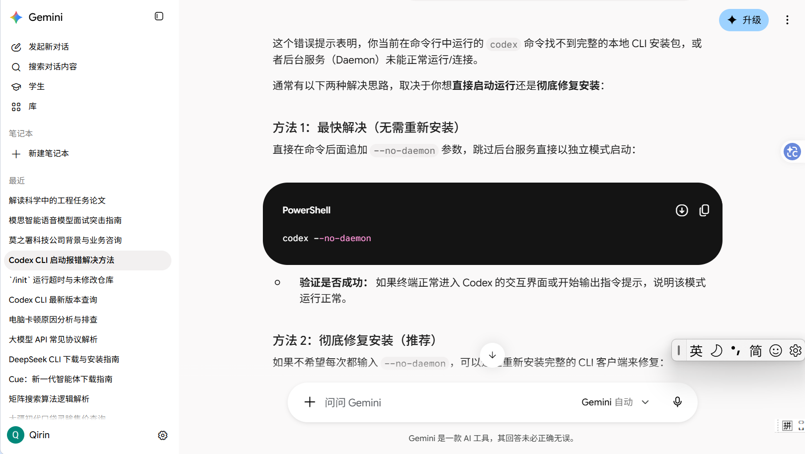
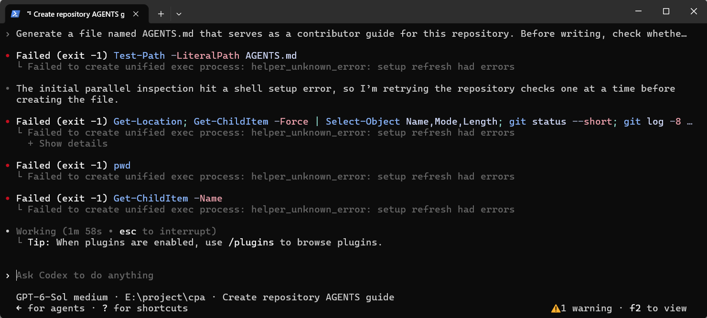
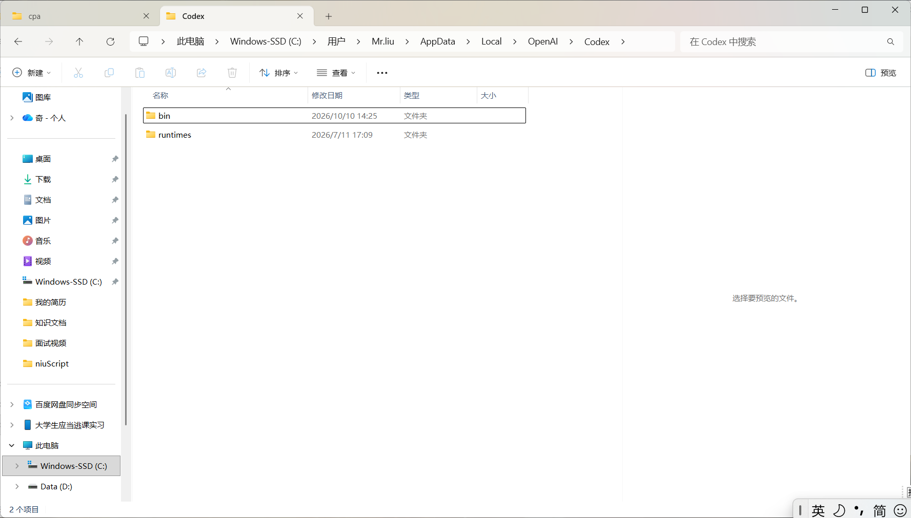

codex cli异常关闭后

# 错误分析一

终端使用codex  cli 无法启动 报错

```script
(base) PS E:\project\cpa> codex

Error: this CLI has no complete local package; install a packaged Codex CLI or use the standalone installer

To work without the background server, rerun the same command with --no-daemon (including resume or fork and its arguments).

(base) PS E:\project\cpa>
```

这个错误提示表明，你当前在命令行中运行的 `codex` 命令找不到完整的本地 CLI 安装包，或者后台服务（Daemon）未能正常运行/连接。

这里我选择了删除 codex cli 安装新版本 (文件和配置 都还在)



# 错误分析二

但是安装了v0.162.0版本后   虽然可以进行正常的启动了  但是还是出现下执行层面的问题如下图




可以看到非常多的执行失败 正常不会这么多 甚至不会有  模型分析了一下 

```
Failed to create unified exec process: helper_unknown_error: setup refresh had errors

真正的症结在内部 Runtime（运行时环境）：Codex 在后台会拉起一个名为 cua_node 的本地沙盒或运行时环境。Windows 重启时可能导致这个内置运行时的缓存文件、依赖包或临时注册表损坏，从而在启动时执行 setup refresh 失败
```


# 修复

删除本地环境下面codex 运行时的所有文件 如下图 bin   和 runtimes



删除之后 ，关闭 所有codex  终端 进行一场初始化（正常codex启动即可） 

执行层的能力就恢复了  （说一下这个恢复 尝试的其他手段 

1. 比如备份用户目录下的.codex 把里面无用的全删掉  但是有关联会话 共100G+  但是实际配置就几十M  我没有走这条路）

2. 接触node文件锁 

   ```
   可以解除，但要先关闭所有 Codex CLI 窗口和 Codex Desktop。否则进程会自动重启，文件锁马上回来。请先保存正在运行的任务，然后在新 PowerShell 中执行：
   $rt = 'C:\Users\Mr.liu\AppData\Local\OpenAI\Codex\runtimes\cua_node\'
   
   Get-Process codex,codex-code-mode-host -ErrorAction SilentlyContinue |
     Stop-Process -Force
   
   Get-Process node,node_repl -ErrorAction SilentlyContinue |
     Where-Object {
       $_.Path -and $_.Path.StartsWith(
         $rt, [StringComparison]::OrdinalIgnoreCase
       )
     } |
     Stop-Process -Force
   这只筛选 Codex 运行时目录下的 node，不会结束其他项目的 Node 程序。随后检查：
   Get-Process node,node_repl -ErrorAction SilentlyContinue |
     Where-Object { $_.Path -like "$rt*" } |
     Select-Object Id,ProcessName,Path
   没有输出表示这组进程已退出。接着先只启动 CLI，且从项目目录运行：
   Set-Location 'E:\project\cpa'
   codex
   让它执行一次 Get-Location 验证。不要从 C:\Windows\System32 启动；上次在那里失败的日志原因是无法修改系统目录权限，和 node.exe 文件锁不同。
   这会释放当前的锁；若只开 CLI 后锁又导致 setup refresh had errors，就说明进程会被 Codex 的启动组件重新拉起，需要继续定位那个组件。不要删除 node.exe 或手动修改 C:\Windows\System32 的权限。
   
   
   星期日17:39
   ```

   没有用

   

   修复执行层的问题，但会有个问题  出现了mcp服务缺失问题 这个羞不羞其实不重要了  主线cli服务已经好了，

