# **企业业务搭建平台**
## **一、平台产生背景**
- 低代码：轻应用 + 低代码（二次开发）
- 无代码：中文规则引擎
2. ## **平台使用**
   ### **2.1 核心思想**
   围绕WSR（物、事、人）核心指导原则，利用本体化思想完成业务搭建。

   本体化（分类、继承、属性、关系、方法）

   ### **2.2 人**
- 组织模型

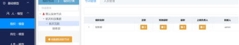

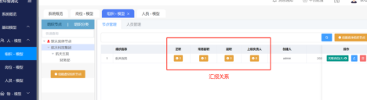

- 岗位模型

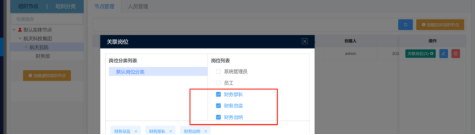

- 人模型

### **2.3 物**
- **实物 - 产品BOM（产品组成）**

- **虚物（表单）**

**主子表**

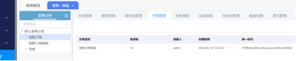

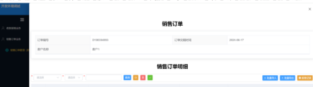

- 关系模型

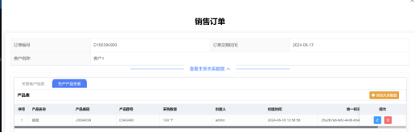

- 动态赋值

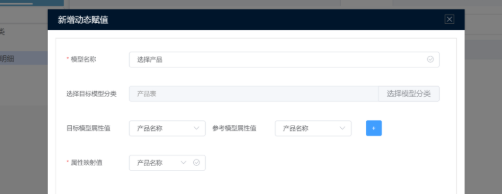

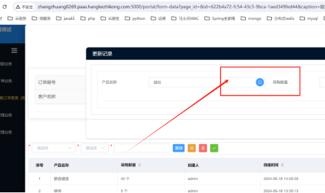
### **2.4 事（审批流程）**
**流程引擎 Bpmn （business process model notation）**

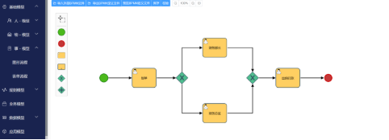

### **2.5 业务建模** 
**搭建业务核心必要元素（人、表单、流程）**

业务建模牵动着对表的数据关联，应用建模则是把业务和表一同部署

**整合WSR元素**

- **流程配置**

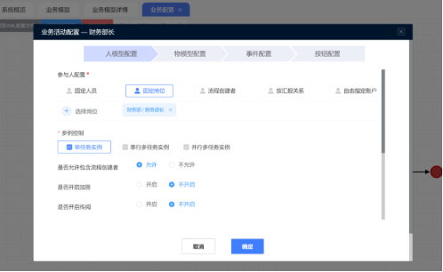

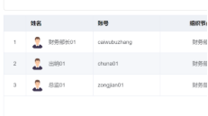

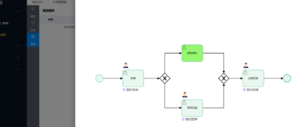

### **2.6 权限控制**
- 系统权限（后台功能菜单） RBAC Role Base Access Control

- 应用权限（前台用户菜单）

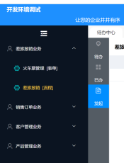

- 数据权限（基于规则控制，行、列）

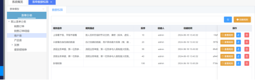

### **2.7 数据模型（116）**

116  一个平台一套方法 六个体系  先我从上至下来说 最终我们要实现数据统计的样式 所以  BI驾驶舱展示是一个体系 这个由各种各样的统计图构成 而统计图关联着统计集 统计集关联着表 表是由 属性 字典 指标来构成的  至此 驾驶舱 统计表 统计集 属性 字典 指标 六个体系 

**一个平台、一套方法、6层体系**

1. **属性**
1. **字典**

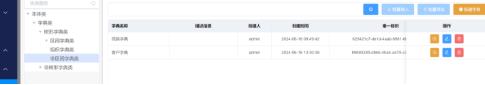

1. **指标**

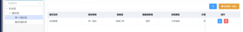

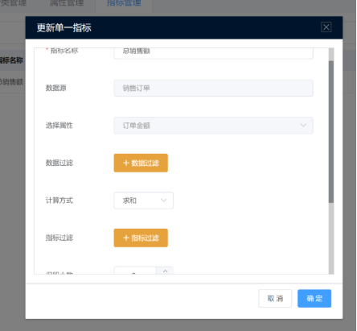

1. **事实表**

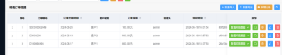

1. **统计表**

**5.1 创建数据集**

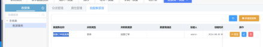

**5.2 创建统计表**

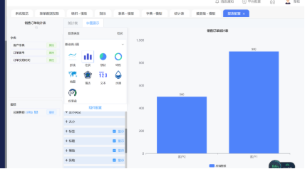

1. **BI驾驶舱**

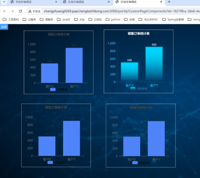

**指标（量化的、需要计算）**

**维度（字典）**

### **2.8 集成中心**
- 数据库集成（重点）
- HTTP-API集成（重点）
- WebSocket集成
- 数据流集成
- 消息中间件（MQ）
### **2.9 运维中心**
- **流程运维**
- **日志审计**
- **数据库运维**

### **2.10 移动中心**
**略过**
